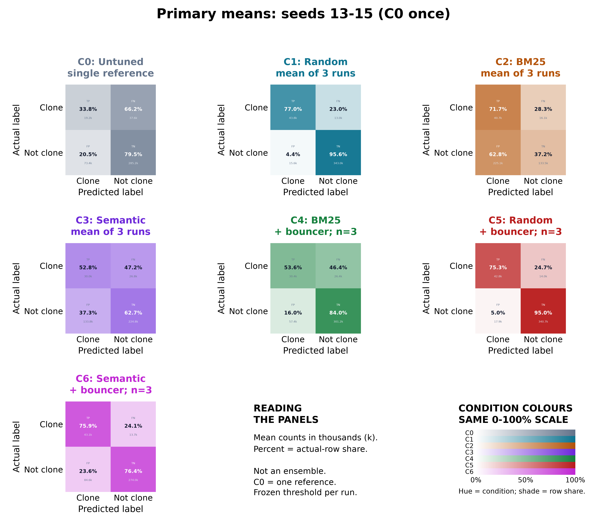
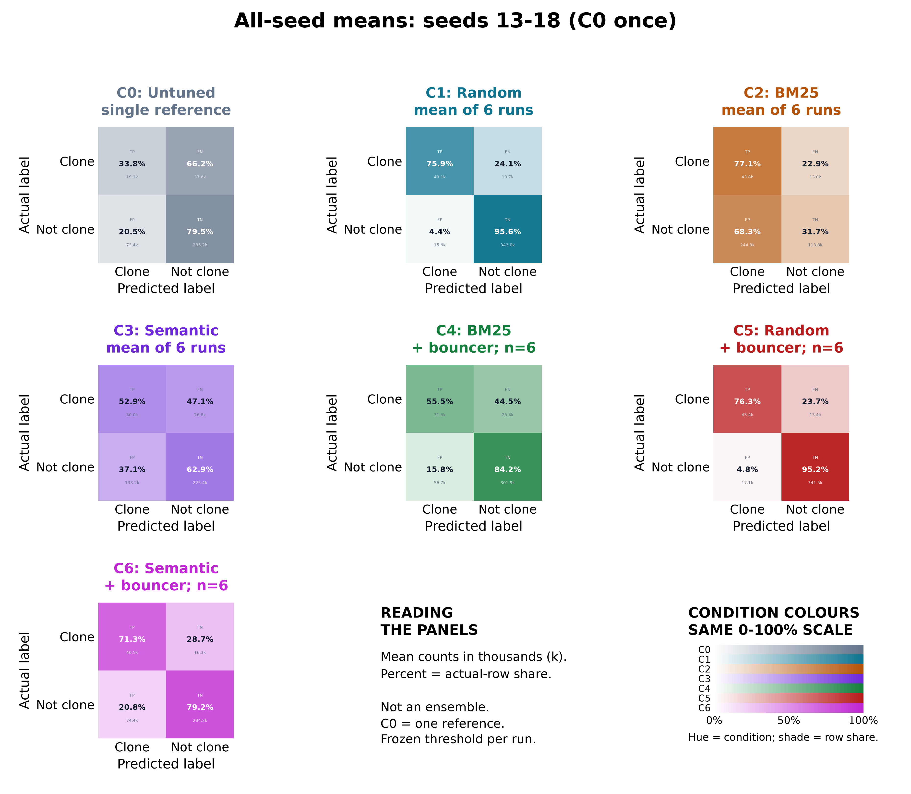

# Benchmark confusion matrices

37 separate model/seed images, 7 primary means, 7 all-seed means and 3 comparison boards.
Style follows Image_Graphs/phase2_confusion_matrices(1).png: condition colours, bold percentages, small tags/counts.
Reference cell fonts are halved: percentages 7.5 pt, tags/counts 4 pt. Numerical data are unchanged.
The 37-run overview is 150 DPI; separate images and mean boards use the requested DPI (default 300).
Only CodeXGLUE benchmark runs are combined; s′ training/transfer/smoke runs are excluded.
C0 is evaluated once, not repeated to manufacture seed replication.

Rows = actual, columns = predicted; order is clone then not-clone: [[TP,FN],[FP,TN]].
Colours/percentages use actual-row normalization. Every panel uses a common 0–100% scale.
Counts in a mean panel are mean pairs per run (may be fractional), not summed pairs.
Each run retains its saved threshold; no mean threshold is used. This is not an ensemble.
Mean seed F1 and F1 recomputed from mean counts are both recorded separately in the JSON.

[All 37 runs](all_runs_board.png)

## Individual runs

- [C0_13](individual/C0_13.png)
- [C1_13](individual/C1_13.png)
- [C1_14](individual/C1_14.png)
- [C1_15](individual/C1_15.png)
- [C1_16](individual/C1_16.png)
- [C1_17](individual/C1_17.png)
- [C1_18](individual/C1_18.png)
- [C2_13](individual/C2_13.png)
- [C2_14](individual/C2_14.png)
- [C2_15](individual/C2_15.png)
- [C2_16](individual/C2_16.png)
- [C2_17](individual/C2_17.png)
- [C2_18](individual/C2_18.png)
- [C3_13](individual/C3_13.png)
- [C3_14](individual/C3_14.png)
- [C3_15](individual/C3_15.png)
- [C3_16](individual/C3_16.png)
- [C3_17](individual/C3_17.png)
- [C3_18](individual/C3_18.png)
- [C4_13](individual/C4_13.png)
- [C4_14](individual/C4_14.png)
- [C4_15](individual/C4_15.png)
- [C4_16](individual/C4_16.png)
- [C4_17](individual/C4_17.png)
- [C4_18](individual/C4_18.png)
- [C5_13](individual/C5_13.png)
- [C5_14](individual/C5_14.png)
- [C5_15](individual/C5_15.png)
- [C5_16](individual/C5_16.png)
- [C5_17](individual/C5_17.png)
- [C5_18](individual/C5_18.png)
- [C6_13](individual/C6_13.png)
- [C6_14](individual/C6_14.png)
- [C6_15](individual/C6_15.png)
- [C6_16](individual/C6_16.png)
- [C6_17](individual/C6_17.png)
- [C6_18](individual/C6_18.png)

## Per-model averages

- C0: [primary](mean_primary/C0_mean.png), [all seeds](mean_all_seeds/C0_mean.png)
- C1: [primary](mean_primary/C1_mean.png), [all seeds](mean_all_seeds/C1_mean.png)
- C2: [primary](mean_primary/C2_mean.png), [all seeds](mean_all_seeds/C2_mean.png)
- C3: [primary](mean_primary/C3_mean.png), [all seeds](mean_all_seeds/C3_mean.png)
- C4: [primary](mean_primary/C4_mean.png), [all seeds](mean_all_seeds/C4_mean.png)
- C5: [primary](mean_primary/C5_mean.png), [all seeds](mean_all_seeds/C5_mean.png)
- C6: [primary](mean_primary/C6_mean.png), [all seeds](mean_all_seeds/C6_mean.png)

## Historical count/metric discrepancies

Plots replay the pinned NPZ scores and thresholds, not legacy JSON counts.
F1 agreement within 5e-4 alone does not establish precision/recall or count equality.
Float32 score/threshold persistence and historical threshold rounding can change ties.
No source artifact or threshold was changed for this export. Exact differences follow:

- C0_13: counts {'fp': {'stored': 73401, 'replayed': 73400}}; metrics {}
- C2_15: counts {'fp': {'stored': 165653, 'replayed': 165655}}; metrics {}
- C3_17: counts {'tp': {'stored': 27229, 'replayed': 29009}, 'fn': {'stored': 29591, 'replayed': 27811}, 'fp': {'stored': 117853, 'replayed': 129298}}; metrics {'precision': {'stored': 0.1877, 'replayed': 0.18324521341444155}, 'recall': {'stored': 0.4792, 'replayed': 0.510542062653995}}
- C4_15: counts {'fp': {'stored': 53908, 'replayed': 53909}}; metrics {}
- C6_14: counts {'fp': {'stored': 75173, 'replayed': 75172}}; metrics {}
- C6_15: counts {'fp': {'stored': 77960, 'replayed': 77959}}; metrics {}
